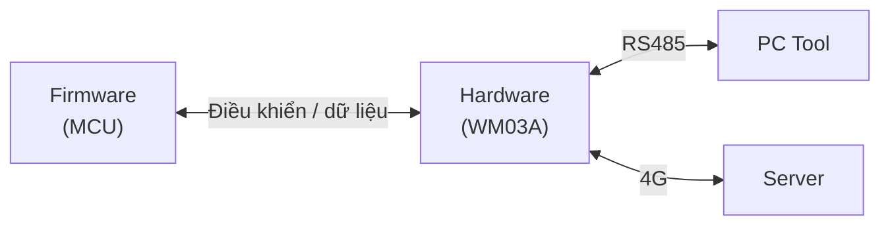

# WM03A System Architecture

## 1. Tổng quan kiến trúc

Hệ thống WM03A gồm bốn khối chức năng chính:

- **Hardware:** Thu thập tín hiệu, xử lý tín hiệu ngoại vi và cung cấp kết nối vật lý.
- **Firmware:** Điều khiển phần cứng, xử lý dữ liệu và quản lý hoạt động của thiết bị.
- **PC Tool:** Cấu hình, giám sát và bảo trì thiết bị tại hiện trường.
- **Server:** Tiếp nhận, lưu trữ và quản lý dữ liệu từ thiết bị.

Các khối phối hợp với nhau thông qua giao tiếp phần cứng và giao thức truyền thông được định nghĩa trong hệ thống.

## 2. Sơ đồ kiến trúc tổng thể

## 3. Kiến trúc phần cứng

STM32L431RCT6 là bộ xử lý trung tâm, chịu trách nhiệm điều khiển các khối phần cứng và thực thi firmware.

| Giao tiếp | Linh kiện | Kết nối bên ngoài | Mục đích |
|---|---|---|---|
| UART | A7677S-LANV | Server (qua 4G) | Điều khiển module 4G, truyền nhận dữ liệu |
| UART | MAX3485 | PC Tool, đồng hồ Modbus RTU (tối đa 4) | Cấu hình thiết bị, thu thập dữ liệu đồng hồ |
| SPI | M95M02 | Không có | Đọc và ghi dữ liệu lưu trữ |
| I2C | MCP3421 | Cảm biến áp suất 4–20 mA (tối đa 2) | Đọc tín hiệu analog |
| I2C | IC sạc pin | Không có | Cấu hình và đọc trạng thái sạc |
| GPIO | Đầu vào xung | Đồng hồ xung 0–3.3 V (tối đa 4) | Thu nhận tín hiệu xung |
| GPIO | STM6823 | Không có | Giám sát MCU |

## 4. Kiến trúc firmware

Firmware chạy trên STM32L431RCT6, chịu trách nhiệm điều khiển hoạt động của thiết bị và xử lý dữ liệu.

Firmware được tổ chức thành bốn layer:

| Layer | Prefix | Trách nhiệm |
|---|---|---|
| Application | `app_` | Điều phối các chức năng ứng dụng |
| Service | `sv_` | Cung cấp dịch vụ và xử lý nghiệp vụ |
| Driver | `drv_` | Điều khiển và giao tiếp với phần cứng |
| System | `sys_` | Cung cấp chức năng hệ thống và tiện ích dùng chung |

Chi tiết về cấu trúc source code, trách nhiệm từng module và luồng thực thi xem tại [Firmware Architecture](../firmware/firmware_architecture.md).

## 5. Kiến trúc phần mềm bên ngoài

### 5.1. PC Tool

PC Tool giao tiếp trực tiếp với WM03A qua kết nối Serial/RS485.

Các chức năng:

- Cấu hình thiết bị.
- Đọc thông tin và dữ liệu vận hành.
- Truy vết lỗi thiết bị.
- Cập nhật firmware.

### 5.2. Server

Server giao tiếp với WM03A qua mạng di động LTE.

Các chức năng:

- Tiếp nhận dữ liệu đo lường.
- Quản lý thông tin thiết bị.
- Giám sát trạng thái thiết bị.
- Quản lý dữ liệu và cấu hình từ xa.

## 6. Tài liệu liên quan