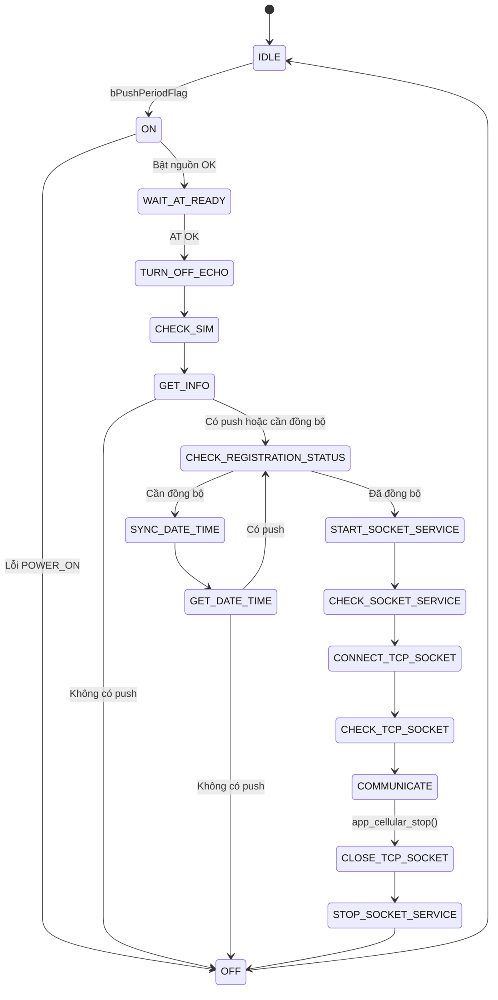

# Quy trình khởi động và giao tiếp với Module 4G

## 1. Tổng quan

MCU điều khiển module 4G A7677S-LANV qua UART bằng tập lệnh AT. Lớp ứng dụng `app_cellular` điều phối toàn bộ vòng đời kết nối theo một máy trạng thái (state machine). Mỗi bước gọi một hàm `sv_cellular_*` tương ứng để gửi lệnh AT và nhận kết quả.

Module được bật khi có phiên push hoặc khi cần đồng bộ thời gian. Sau khi xong việc, module được tắt để tiết kiệm năng lượng.

## 2. Phân lớp

| Lớp | Hàm tiêu biểu | Trách nhiệm |
|---|---|---|
| Application | `app_cellular_*` | Điều phối trạng thái, quyết định bước tiếp theo, quản lý retry |
| Service | `sv_cellular_*` | Gửi từng lệnh AT, phân tích phản hồi, trả `Cellular_Task_Status_t` |
| Driver | `drv_lte_*` | Truyền nhận UART, bật/tắt nguồn module qua TPS63100 |

Kết quả của mỗi hàm `sv_cellular_*` có ba giá trị:

- `CELLULAR_TASK_WAIT`: lệnh chưa xong, cần gọi lại ở vòng sau.
- `CELLULAR_TASK_DONE`: lệnh thành công.
- Giá trị khác: lệnh thất bại.

## 3. Các bước trong máy trạng thái

Thứ tự bước khi khởi động và kết nối:

| Bước | Hàm xử lý | Nội dung | Thành công chuyển sang | Thất bại |
|---|---|---|---|---|
| `IDLE` | - | Chờ phiên push (`bPushPeriodFlag`) | `ON` | - |
| `ON` | `sv_cellular_on` | Bật nguồn module | `WAIT_AT_READY` | `OFF`, lỗi `POWER_ON` |
| `WAIT_AT_READY` | `sv_cellular_check_at` | Kiểm tra module phản hồi AT | `TURN_OFF_ECHO` | Thử lại đến `CELLULAR_RETRY`, rồi `OFF`, lỗi `AT_READY` |
| `TURN_OFF_ECHO` | `sv_cellular_off_echo` | Tắt echo lệnh AT | `CHECK_SIM` | Thử lại, rồi `OFF`, lỗi `AT_READY` |
| `CHECK_SIM` | `sv_cellular_check_sim` | Kiểm tra SIM sẵn sàng | `GET_INFO` | Thử lại, rồi `OFF`, lỗi `SIM_NOT_READY` |
| `GET_INFO` | `sv_cellular_get_ccid`, `sv_cellular_check_signal_quality` | Đọc CCID, đọc chất lượng sóng | `CHECK_REGISTRATION_STATUS` nếu có push hoặc cần đồng bộ thời gian, ngược lại `OFF` | Xem mục [Thử lại](#5-retry-và-timeout) |
| `CHECK_REGISTRATION_STATUS` | `sv_cellular_check_registration_status` | Kiểm tra đăng ký mạng | `SYNC_DATE_TIME` nếu cần đồng bộ, ngược lại `START_SOCKET_SERVICE` | Thử lại, rồi `OFF`, lỗi `NETWORK_NOT_REGISTERED` |
| `SYNC_DATE_TIME` | `sv_cellular_update_system_time` | Đồng bộ thời gian qua NTP, lần lượt 3 server | `GET_DATE_TIME` | Đổi server, hết server thì `OFF`, lỗi `DATE_TIME_SYNC` |
| `GET_DATE_TIME` | `sv_cellular_get_time`, `sv_time_set_date_time` | Lấy thời gian từ module và ghi vào hệ thống | Có push: `CHECK_REGISTRATION_STATUS`; không push: `OFF` | Thử lại, rồi `OFF`, lỗi `GET_DATE_TIME` |
| `START_SOCKET_SERVICE` | `sv_cellular_start_socket_service` | Khởi động dịch vụ socket | `CHECK_SOCKET_SERVICE` | Thử lại, rồi `STOP_SOCKET_SERVICE`, lỗi `SOCKET_SERVICE_NOT_READY` |
| `CHECK_SOCKET_SERVICE` | `sv_cellular_check_socket_service` | Kiểm tra dịch vụ socket đã sẵn sàng | `CONNECT_TCP_SOCKET` | Khởi động lại dịch vụ, hết lượt thì `STOP_SOCKET_SERVICE` |
| `CONNECT_TCP_SOCKET` | `sv_cellular_connect_tcp_socket` | Kết nối TCP tới IP và cổng trong `Ip_Endpoint_t` | `CHECK_TCP_SOCKET` | Thử lại, rồi `STOP_SOCKET_SERVICE`, lỗi `TCP_CONNECT` |
| `CHECK_TCP_SOCKET` | `sv_cellular_check_tcp_socket` | Kiểm tra kết nối TCP | `COMMUNICATE` | Kết nối lại, hết lượt thì `STOP_SOCKET_SERVICE`, lỗi `TCP_CONNECT` |
| `COMMUNICATE` | - | Đặt `bConnectedFlag = true`, cho phép gửi nhận | Chờ `app_cellular_stop()` | - |

Bước kết thúc:

| Bước | Hàm xử lý | Nội dung |
|---|---|---|
| `CLOSE_TCP_SOCKET` | `sv_cellular_close_tcp_socket` | Đóng kết nối TCP, đặt `bConnectedFlag = false` |
| `STOP_SOCKET_SERVICE` | `sv_cellular_stop_socket_service` | Dừng dịch vụ socket |
| `OFF` | `sv_cellular_off` | Tắt module, xóa cờ CCID và chất lượng sóng, đặt lại bộ đếm retry |
| `RESET` | `sv_cellular_reset` | Reset module. |

Đường đi thông thường khi push:

```text
IDLE → ON → WAIT_AT_READY → TURN_OFF_ECHO → CHECK_SIM → GET_INFO
     → CHECK_REGISTRATION_STATUS → [SYNC_DATE_TIME → GET_DATE_TIME]
     → START_SOCKET_SERVICE → CHECK_SOCKET_SERVICE → CONNECT_TCP_SOCKET
     → CHECK_TCP_SOCKET → COMMUNICATE
     → CLOSE_TCP_SOCKET → STOP_SOCKET_SERVICE → OFF → IDLE
```

## 4. Lưu đồ trạng thái



Các nhánh lỗi đã bỏ khỏi sơ đồ để dễ đọc. Xem bảng ở mục 3.

## 5. Retry và timeout

| Thông số | Ý nghĩa |
|---|---|
| `CELLULAR_RETRY` | Số lần thử lại tối đa cho mỗi bước (tối đa 3 lần) |
| `AT_COMMAND_RESPONSE_TIMEOUT_NETWORK` | Thời gian tối đa chờ kết nối mạng và socket (120 giây). |
| `NTP_SERVER_PRIMARY`, `NTP_SERVER_BACKUP_1`, `NTP_SERVER_BACKUP_2` | Danh sách server NTP, thử theo thứ tự (`time.google.com`, `time.windows.com`, `vn.pool.ntp.org`) |

Quy tắc chung:

- Mỗi bước có bộ đếm `u8RetryCount` riêng. Khi thành công, bộ đếm được đặt về 0.
- Kiểm tra socket và TCP có thêm bộ đếm theo thời gian (`u32TimeConnect`). Nếu quá thời gian mà vẫn `WAIT`, bước được coi là thất bại.

Hành vi với thông tin CCID và chất lượng sóng (bước `GET_INFO`):

- Nếu đọc CCID thất bại đủ số lần thử, cờ đã yêu cầu được đặt để chuyển tiếp, nhưng `bCcidInfoValid` vẫn là `false`.
- Với chất lượng sóng, xem ghi chú ở mục 8.

## 6. Truyền nhận dữ liệu

Dữ liệu chỉ được gửi và nhận khi `bConnectedFlag = true`, tức là sau khi vào bước `COMMUNICATE`.

| Hàm | Hành vi |
|---|---|
| `app_cellular_send_data(pData, u16Len)` | Gọi `sv_cellular_send_data` đến khi không còn `WAIT`. Trả `true` nếu đang chờ hoàn tất, `false` nếu lỗi hoặc chưa kết nối |
| `app_cellular_receive_data(pData, pLen)` | Gọi `sv_cellular_receive_data` đến khi không còn `WAIT`. Trả `true` nếu nhận được dữ liệu |
| `app_cellular_get_connection_status()` | Trả giá trị `bConnectedFlag` |

## 7. Kết thúc phiên và báo lỗi

Khi `app_push_execute` gọi `app_cellular_stop()`, trạng thái chuyển sang `CLOSE_TCP_SOCKET`, rồi tuần tự đóng socket, dừng dịch vụ và tắt module.

Ở bước `OFF`:

- Nếu đang có phiên push (`bPushPeriodFlag`), đặt `bCellularResultReady = true` để báo kết quả.
- Xóa toàn bộ cờ phiên.

Kết quả được đọc một lần qua `app_cellular_get_error()`. Hàm này xóa `eCellularError` và `bCellularResultReady` sau khi đọc. Nếu gọi lần thứ hai sẽ nhận `false`.

Bảng `Cellular_Error_t` dùng để ghi vào Push Status:

| Giá trị | Tên | Nguyên nhân |
|---|---|---|
| 0 | `CELLULAR_ERROR_NONE` | Thành công |
| 1 | `CELLULAR_ERROR_POWER_ON` | Không bật được module |
| 2 | `CELLULAR_ERROR_AT_READY` | Module không phản hồi AT |
| 3 | `CELLULAR_ERROR_SIM_NOT_READY` | SIM chưa sẵn sàng |
| 4 | `CELLULAR_ERROR_NETWORK_NOT_REGISTERED` | Chưa đăng ký mạng |
| 5 | `CELLULAR_ERROR_SOCKET_SERVICE_NOT_READY` | Dịch vụ socket chưa sẵn sàng |
| 6 | `CELLULAR_ERROR_DATE_TIME_SYNC` | Đồng bộ NTP thất bại trên cả ba server |
| 7 | `CELLULAR_ERROR_GET_DATE_TIME` | Không lấy được thời gian từ module |
| 8 | `CELLULAR_ERROR_TCP_CONNECT` | Không kết nối được TCP |

## 8. Tài liệu liên quan