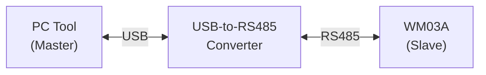
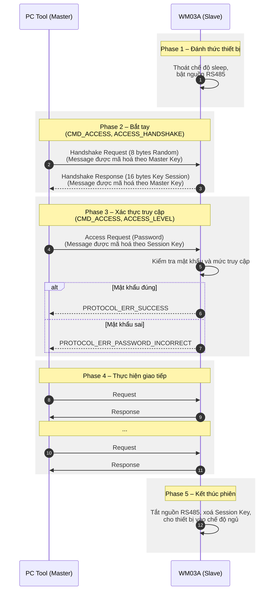

# RS485 Communication – PC Tool

## 1. Tổng quan

WM03A hỗ trợ giao tiếp với PC Tool thông qua giao diện RS485, cho phép người dùng cấu hình, giám sát và quản lý thiết bị trực tiếp từ máy tính.

PC Tool kết nối với WM03A thông qua bộ chuyển đổi USB-to-RS485. Dữ liệu được trao đổi theo mô hình Master–Slave, trong đó:

- **PC Tool (Master):** Khởi tạo yêu cầu và gửi lệnh đến thiết bị.
- **WM03A (Slave):** Tiếp nhận, xử lý yêu cầu và gửi phản hồi về PC Tool.

Giao tiếp RS485 sử dụng phương thức truyền bán song công (Half-Duplex), do đó tại một thời điểm chỉ một thiết bị được phép truyền dữ liệu trên đường truyền.

## 2. Kiến trúc giao tiếp

### 2.1. Sơ đồ kết nối

### 2.2. Thành phần giao tiếp

| Thành phần | Chức năng |
|---|---|
| PC Tool | Gửi lệnh, nhận phản hồi và hiển thị dữ liệu |
| USB-to-RS485 Converter | Chuyển đổi USB sang tín hiệu RS485 |
| MAX3485 | Chuyển đổi tín hiệu UART và RS485 trên WM03A |
| STM32L431RCT6 | Tiếp nhận và xử lý dữ liệu giao tiếp |

### 2.3. Thông số giao tiếp

| Thông số | Giá trị |
|---|---|
| Giao diện vật lý | RS485 |
| Phương thức truyền | Half-Duplex |
| Mô hình giao tiếp | Master–Slave |
| Thiết bị Master | PC Tool |
| Thiết bị Slave | WM03A |
| Baud Rate | 19.200 |
| Data Bits | 8 |
| Parity | None |
| Stop Bits | 1 |

## 3. Cấu trúc khung dữ liệu

Mỗi gói tin trao đổi giữa PC Tool và WM03A được đóng gói theo cấu trúc giao thức riêng của thiết bị.

| Trường | Kích thước | Mô tả |
|---|---:|---|
| SOF | 1 B | Byte bắt đầu khung (`0x5A`) |
| TYPE | 1 B | Mã định danh thiết bị (`0x03`) |
| SERIAL | 8 B | Số serial của thiết bị |
| CMD | 1 B | Mã lệnh chức năng |
| ID | 1 B | Mã định danh tham số/sub-command |
| LEN | 2 B | Độ dài MESSAGE |
| MESSAGE | n B | Thông tin trao đổi |
| CRC | 2 B | Mã kiểm tra tính toàn vẹn của frame tính từ STX đến hết MESSAGE (Modbus CRC16) |

Chi tiết định nghĩa từng trường, cách mã hóa và kiểm tra tính hợp lệ của khung được trình bày trong tài liệu [Protocol](../communication/protocol.md).

## 4. Quy trình hoạt động

### 4.1. Đánh thức thiết bị

Để đánh thức WM03A, đặt một nam châm có từ trường đủ mạnh gần vị trí cảm biến từ của thiết bị. Khi phát hiện tác động từ trường, MCU sẽ thoát khỏi chế độ ngủ và kích hoạt cổng giao tiếp quang trong thời gian 10 giây.

### 4.2. Thiết lập Session Key (Handshake)

Trước khi thực hiện các lệnh giao tiếp, PC Tool và WM03A phải thiết lập Session Key thông qua lệnh bắt tay:

- **Command:** `CMD_ACCESS` (`0x00`)
- **ID:** `ACCESS_HANDSHAKE` (`0x00`)

Quy trình bắt tay được thực hiện như sau:

1. PC Tool tạo 8 bytes dữ liệu ngẫu nhiên (`Tool Random`) và gửi đến MCU. Bản tin được mã hóa bằng Master Key.
2. MCU giải mã và tiếp nhận `Tool Random`, sau đó tạo thêm 8 bytes dữ liệu ngẫu nhiên (`MCU Random`).
3. MCU ghép hai chuỗi dữ liệu theo thứ tự `Tool Random + MCU Random` để tạo thành Session Key có độ dài 16 bytes.
4. MCU gửi lại 16 bytes Session Key cho PC Tool. Bản tin phản hồi được mã hóa bằng Master Key.
5. Sau khi hoàn tất quá trình bắt tay, PC Tool và MCU sử dụng Session Key vừa thiết lập để mã hóa và giải mã các bản tin tiếp theo.

### 4.3. Xác thực quyền truy cập (Login)

Sau khi thiết lập Session Key thành công, PC Tool cần thực hiện đăng nhập để xác thực quyền truy cập vào thiết bị.

Lệnh đăng nhập sử dụng:

- **Command:** `CMD_ACCESS` (`0x00`)
- **ID:** `ACCESS_LEVEL_1` (`0x01`), `ACCESS_LEVEL_2` (`0x02`) hoặc `ACCESS_LEVEL_3` (`0x03`)

PC Tool gửi yêu cầu đăng nhập bao gồm mật khẩu tương ứng với cấp độ truy cập mong muốn. Bản tin được mã hóa bằng Session Key.

Thiết bị hỗ trợ ba cấp độ quyền truy cập:

- **Mức 1 – Quyền người vận hành (Operator):** `ACCESS_LEVEL_1`.
- **Mức 2 – Quyền quản trị viên (Admin):** `ACCESS_LEVEL_2`.
- **Mức 3 – Quyền nhà máy (Factory):** `ACCESS_LEVEL_3`.

MCU giải mã yêu cầu, kiểm tra mật khẩu tương ứng với cấp độ truy cập được yêu cầu và phản hồi kết quả xác thực về PC Tool.

- Nếu mật khẩu chính xác, MCU cấp quyền truy cập tương ứng và trả về `PROTOCOL_ERR_SUCCESS`.
- Nếu mật khẩu không chính xác, MCU trả về `PROTOCOL_ERR_PASSWORD_INCORRECT`.
- Nếu ID không hợp lệ, MCU trả về `PROTOCOL_ERR_CMD_INVALID`.

**Chú ý:** Để đăng nhập vào cấp độ `ACCESS_LEVEL_3` (Factory), bắt buộc phải kết nối jumper tương ứng trên mạch phần cứng. Nếu jumper không được kết nối, thiết bị sẽ từ chối yêu cầu đăng nhập và trả về `PROTOCOL_ERR_PASSWORD_INCORRECT`, kể cả khi mật khẩu được cung cấp là chính xác.

### 4.4. Duy trì và kết thúc phiên giao tiếp

Session Key được duy trì trong thời gian tối đa 30 giây kể từ lần giao tiếp gần nhất. Mỗi khi phát sinh giao tiếp, thời gian chờ được tính lại.

Nếu không có giao tiếp trong vòng 30 giây, MCU sẽ thực hiện các thao tác sau:

- Xóa Session Key khỏi bộ nhớ.
- Tắt cổng RS485.
- Đưa thiết bị trở về chế độ ngủ.

Sau khi phiên giao tiếp kết thúc, muốn tiếp tục giao tiếp, người dùng cần đánh thức thiết bị và thực hiện lại quá trình bắt tay để thiết lập Session Key mới.

**Lưu ý:**

- Chỉ các bản tin thuộc quá trình bắt tay (`CMD_ACCESS`, `ACCESS_HANDSHAKE`) sử dụng Master Key. Tất cả các lệnh tiếp theo, bao gồm lệnh đăng nhập (`ACCESS_LEVEL`), đều sử dụng Session Key.
- Nếu MCU nhận được một lệnh bắt tay mới trong khi phiên giao tiếp hiện tại vẫn đang hoạt động, MCU sẽ sử dụng Master Key để xử lý lệnh bắt tay và thiết lập Session Key mới. Session Key mới thay thế Session Key hiện tại và được sử dụng cho các lệnh giao tiếp tiếp theo. PC Tool cần thực hiện đăng nhập lại để xác thực quyền truy cập trong phiên mới.

## 5. Cơ chế bảo vệ thiết bị

### 5.1. Bảo vệ lỗi giao tiếp

- Khi nhận được bản tin không đúng định dạng Frame theo quy định trong tài liệu [Protocol](../communication/protocol.md) hoặc không thể giải mã Message, thiết bị sẽ tăng biến đếm `u8FrameFailCount`.
- Khi số lần xảy ra lỗi liên tiếp đạt 20 lần (`u8FrameFailCount >= 20`), thiết bị sẽ khóa cổng giao tiếp RS485 trong vòng **120 giây**.
- Biến đếm `u8FrameFailCount` được reset về 0 khi cơ chế bảo vệ được kích hoạt hoặc khi thiết bị nhận được Frame có thể giải mã thành công.

### 5.2. Bảo vệ mật khẩu

- Khi đăng nhập sai mật khẩu liên tiếp 5 lần (`u8PasswordFailCount >= 5`), thiết bị sẽ khóa cổng giao tiếp RS485 trong vòng **60 giây**.
- Kể từ lần đăng nhập sai thứ 6, mỗi lần đăng nhập sai tiếp theo đều khiến cổng giao tiếp RS485 bị khóa trong vòng **60 giây**.
- Biến đếm `u8PasswordFailCount` chỉ được reset về 0 khi đăng nhập thành công vào thiết bị.

## 6. Tài liệu liên quan
