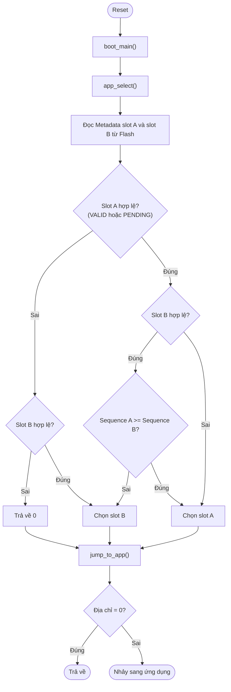

# Bootloader WM03A

## 1. Tổng quan

Bootloader là chương trình chạy đầu tiên sau khi MCU reset. Nhiệm vụ của bootloader là chọn firmware hợp lệ có số thứ tự (`u32Sequence`) lớn nhất trong hai slot A và B, sau đó nhảy sang vùng firmware đó để thực thi.

Bootloader không tham gia vào quá trình tải firmware. Việc ghi firmware mới (OTA) do ứng dụng thực hiện, xem [OTA](../communication/ota.md).

## 2. Vị trí trong Flash

Bootloader nằm ở vùng đầu Flash của STM32L431RCT6 (xem [Flash Layout](flash.md)).

| Vùng | Địa chỉ bắt đầu | Kích thước | Ghi chú |
|---|---|---|---|
| Bootloader | `0x08000000` | 32 KB | `BOOTLOADER_START_ADDR` |
| Slot A Metadata | `0x08008000` | 2 KB | `SLOT_A_METADATA_ADDR` |
| Slot A Firmware | `0x08008800` | 110 KB | `SLOT_A_START_ADDR` |
| Slot B Metadata | `0x08024000` | 2 KB | `SLOT_B_METADATA_ADDR` |
| Slot B Firmware | `0x08024800` | 110 KB | `SLOT_B_START_ADDR` |

Vùng `BOOT_VERSION` (`0x08007FF0`, 16 B) chứa chuỗi phiên bản bootloader. Biến `au8Verison` được đặt trong section `.boot_version` với nội dung `"V1.0.1"`, tối đa 10 byte theo định dạng `Vxx.xx.xxx`.

## 3. Luồng khởi động

Sau `jump_to_app()`, nếu không có firmware hợp lệ thì hàm trả về và `boot_main()` chạy `boot_blink_led()`.

## 4. Chọn firmware

Bootloader đọc `Firmware_Metadata_t` của hai slot và xác định slot hợp lệ theo `eStatus`:

| Trạng thái | Hợp lệ khi khởi động |
|---|---|
| `FIRMWARE_VALID` | Có |
| `FIRMWARE_PENDING` | Có |
| Khác | Không |

Quy tắc chọn:

1. Nếu cả hai slot không hợp lệ: không nhảy, chuyển sang chỉ thị LED báo lỗi.
2. Nếu chỉ một slot hợp lệ: chọn slot đó.
3. Nếu cả hai hợp lệ: chọn slot có `u32Sequence` lớn hơn. Khi bằng nhau, chọn slot A.

Trạng thái `FIRMWARE_PENDING` được đặt cho firmware vừa được ghi mới. Chuyển sang `FIRMWARE_VALID` do chính firmware quyết định khi nó chạy ổn định trong vòng 1 phút mà không bị reset bất thường. Nếu firmware reset trong thời gian này, nó vẫn ở trạng thái `FIRMWARE_PENDING`.

## 5. Nhảy sang ứng dụng

Hàm `jump_to_app()` thực hiện:

1. Đọc giá trị MSP (word 0) và địa chỉ Reset Handler (word 1) từ bảng vector của slot được chọn.
2. Gọi `HAL_RCC_DeInit()` và `HAL_DeInit()` để đưa ngoại vi về trạng thái ban đầu.
3. Tắt ngắt toàn cục, tắt SysTick.
4. Xóa các bit bật fault handler trong `SCB->SHCSR`.
5. Đặt MSP bằng giá trị đọc được.
6. Bật lại ngắt.
7. Đặt `SCB->VTOR` trỏ đến đầu slot.
8. Gọi Reset Handler của ứng dụng.

Nếu địa chỉ slot bằng 0, hàm trả về mà không nhảy.

## 6. Báo hiệu LED

Hàm `boot_blink_led()` nhấp nháy hai chân PC7 và PC9 xen kẽ với chu kỳ 100 ms. Hàm chạy vô hạn, được gọi khi `jump_to_app()` trả về (không có firmware hợp lệ).

| Chân | Trạng thái ban đầu |
|---|---|
| PC7 | Mức cao |
| PC9 | Mức thấp |

Mỗi vòng lặp đảo trạng thái cả hai chân, nên hai LED nhấp nháy ngược pha.

## 7. Tài liệu liên quan