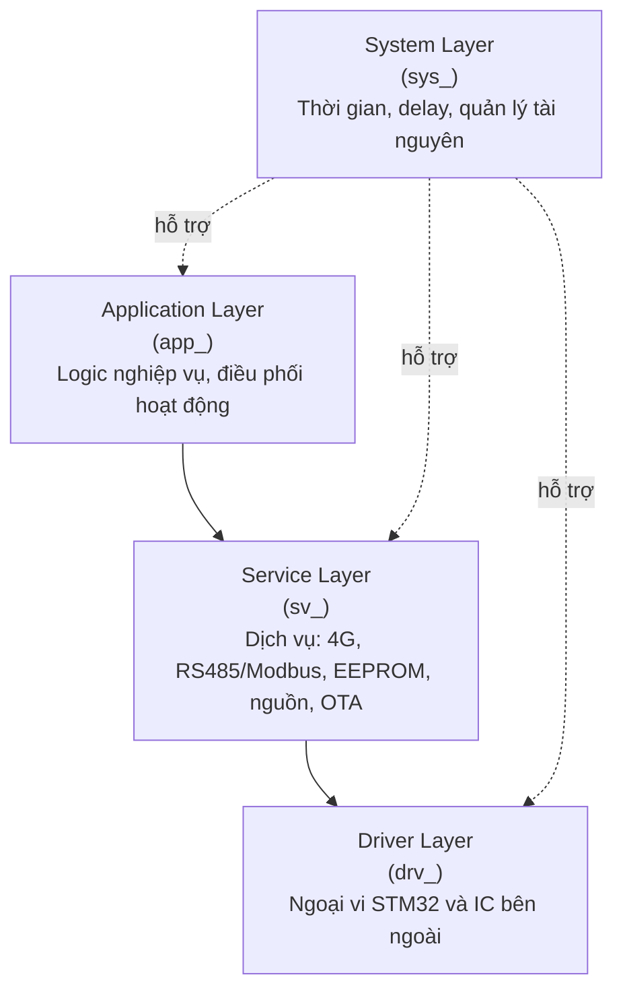
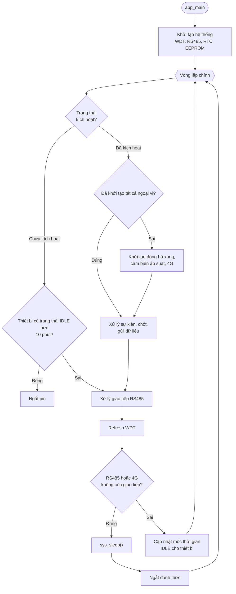

# WM03A Firmware Architecture

## 1. Tổng quan

Firmware WM03A chạy trên vi điều khiển STM32L431RCT6, được viết bằng ngôn ngữ C. Firmware đảm nhiệm các chức năng:

- Điều khiển hoạt động của thiết bị.
- Thu thập dữ liệu từ đồng hồ nước và cảm biến áp suất.
- Lưu trữ dữ liệu và cấu hình trong EEPROM.
- Giao tiếp với module 4G và RS485.
- Xử lý các yêu cầu cấu hình từ PC Tool.

Firmware được tổ chức theo kiến trúc phân lớp nhằm tách rõ phần cứng, dịch vụ và logic ứng dụng. Cách tổ chức này giúp giảm phụ thuộc giữa các module và thuận tiện cho bảo trì, kiểm thử và mở rộng.

## 2. Kiến trúc phân lớp

| Lớp | Prefix | Trách nhiệm |
|---|---|---|
| Application | `app_` | Xử lý logic nghiệp vụ và điều phối hoạt động của thiết bị |
| Service | `sv_` | Cung cấp dịch vụ quản lý dữ liệu, truyền thông, lưu trữ và cập nhật firmware |
| Driver | `drv_` | Điều khiển ngoại vi STM32 và IC bên ngoài |
| System | `sys_` | Cung cấp chức năng hệ thống: thời gian, delay, quản lý tài nguyên |

### 2.1. Application Layer

Application Layer là lớp cao nhất, điều phối hoạt động của firmware và triển khai logic nghiệp vụ. Các chức năng chính:

- Quản lý trạng thái hoạt động của thiết bị.
- Điều phối thu thập dữ liệu từ đồng hồ nước và cảm biến áp suất.
- Quản lý chu kỳ lưu trữ và truyền dữ liệu.
- Xử lý yêu cầu cấu hình và điều khiển từ bên ngoài.

### 2.2. Service Layer

Service Layer cung cấp các dịch vụ, đóng vai trò trung gian giữa Application Layer và Driver Layer. Các nhóm chức năng chính:

- Giao tiếp với module 4G (A7677S-LANV) qua AT command.
- Giao tiếp RS485 và xử lý giao thức Modbus RTU.
- Quản lý dữ liệu và bộ nhớ EEPROM.
- Quản lý nguồn và trạng thái các thiết bị ngoại vi.
- Xử lý cập nhật firmware OTA.

### 2.3. Driver Layer

Driver Layer điều khiển trực tiếp các ngoại vi của STM32 và IC bên ngoài. Các nhóm driver chính:

- Ngoại vi STM32: GPIO, UART, SPI, I2C, ADC, Timer.
- Xử lý tín hiệu xung đầu vào.
- Giao tiếp EEPROM M95M02 (SPI).
- Giao tiếp ADC ngoài MCP3421 (I2C).
- Điều khiển IC sạc BQ25895 (I2C) và watchdog STM6823.
- Điều khiển module 4G và bộ thu phát RS485 MAX3485.

### 2.4. System Layer

System Layer cung cấp chức năng nền tảng cho firmware:

- Quản lý thời gian hệ thống.
- Delay và các hàm hỗ trợ thời gian.
- Quản lý trạng thái hệ thống.
- Tiện ích phụ thuộc nền tảng vi điều khiển.

### 2.5. Sơ đồ phụ thuộc giữa các tầng

## 3. Nguyên tắc phụ thuộc giữa các lớp

- Application Layer chỉ sử dụng dịch vụ do Service Layer cung cấp.
- Service Layer sử dụng Driver Layer để tương tác với phần cứng.
- Driver Layer truy cập ngoại vi thông qua thư viện HAL hoặc thanh ghi khi cần thiết.
- System Layer cung cấp hàm hỗ trợ cho các lớp phía trên.
- Các module giao tiếp qua interface được định nghĩa rõ, không truy cập trực tiếp dữ liệu nội bộ của module khác.

## 4. Luồng xử lý

## 5. Tài liệu liên quan

