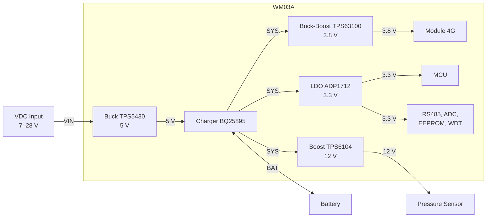
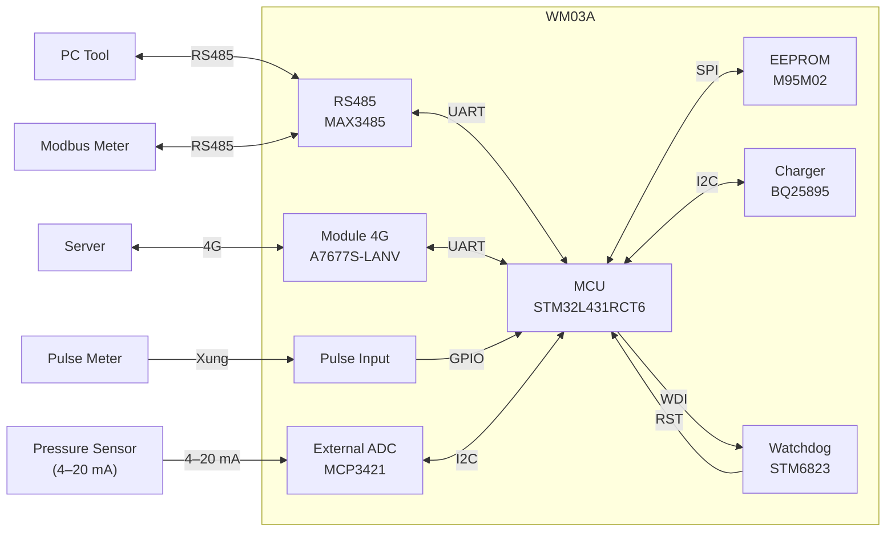

# WM03A Hardware Design

## 1. Tổng quan

WM03A là thiết bị thu thập dữ liệu đồng hồ nước (Water Meter Datalogger), sử dụng vi điều khiển STM32L431RCT6 làm bộ xử lý trung tâm.

Thiết bị thu thập xung từ đồng hồ nước (Pulse), dữ liệu từ đồng hồ Modbus RTU qua RS485, và giá trị áp suất từ cảm biến 4–20 mA. Dữ liệu được lưu cục bộ trong EEPROM và truyền lên Server qua mạng 4G.

Các khối chức năng chính:

| Khối | Linh kiện | Ghi chú |
|---|---|---|
| Main Controller | STM32L431RCT6 | Bộ xử lý trung tâm |
| Cellular | A7677S-LANV | Truyền thông 4G, điều khiển bằng AT command |
| RS485 | MAX3485 | Giao tiếp Modbus RTU, bán song công |
| Analog Input | MCP3421 | ADC 18-bit ngoài, đo cảm biến 4–20 mA |
| Non-volatile Storage | M95M02 | EEPROM 2 Mbit, giao tiếp SPI |
| Battery Charger | BQ25895 | Quản lý sạc pin, giao tiếp I2C |
| Watchdog | STM6823 | Giám sát và reset MCU |
| Pulse Input | GPIO | Đếm xung từ đồng hồ nước |
| Power | TPS5430, TPS63100, ADP1712, TPS6104 | Chuyển đổi và quản lý nguồn |

## 2. Sơ đồ khối hệ thống

### 2.1. Sơ đồ khối nguồn

### 2.2. Sơ đồ khối giao tiếp

## 3. Main Controller

### 3.1. STM32L431RCT6

STM32L431RCT6 điều khiển toàn bộ ngoại vi và thực thi firmware. Các chức năng chính:

- Thu thập và đếm xung từ đồng hồ nước.
- Đọc giá trị áp suất từ ADC ngoài qua I2C.
- Điều khiển nguồn và giao tiếp với module 4G qua UART.
- Ghi/đọc dữ liệu cấu hình và dữ liệu vận hành trong EEPROM qua SPI.
- Cấu hình và đọc trạng thái IC sạc qua I2C.
- Gửi tín hiệu heartbeat tới watchdog qua chân WDI.

### 3.2. Giao tiếp ngoại vi

| Ngoại vi | Thiết bị kết nối | Chức năng |
|---|---|---|
| UART | Module 4G, MAX3485 | Truyền dữ liệu AT command và Modbus RTU |
| SPI | EEPROM M95M02 | Lưu trữ cấu hình và dữ liệu |
| I2C | MCP3421, BQ25895 | Đọc ADC, cấu hình sạc |
| GPIO (Input) | Đầu vào xung | Đếm xung từ đồng hồ nước |
| GPIO (Output) | Công tắc nguồn, enable, WDI | Bật/tắt nguồn ngoại vi, enable module, heartbeat |

Chi tiết phân bổ chân xem tại [Pinout](pinout.md).

## 4. Khối giao tiếp

### 4.1. Truyền thông di động

Module: A7677S-LANV

MCU bật/tắt module qua bộ chuyển đổi Buck-Boost TPS63100 và giao tiếp qua UART với tập lệnh AT.

Chức năng chính:

- Khởi động và reset module.
- Kiểm tra trạng thái đăng ký mạng.
- Thiết lập kết nối dữ liệu (PDP context).
- Truyền và nhận dữ liệu với Server.

### 4.2. Giao tiếp RS485

Transceiver: MAX3485

MAX3485 là bộ thu phát RS485 bán song công, dùng cho giao tiếp với đồng hồ nước Modbus RTU và PC Tool.

- MCU giao tiếp với MAX3485 qua UART.
- Chân DE/RE được MCU điều khiển để chuyển hướng truyền/nhận.
- MCU ngắt nguồn MAX3485 bằng MOSFET công tắc nguồn khi không cần giao tiếp, nhằm giảm tiêu thụ.

### 4.3. Đầu vào xung

Khối này nhận tín hiệu xung từ đồng hồ nước để xác định lượng nước tiêu thụ.

- MCU xuất GPIO output để cấp nguồn kéo lên 3.3 V cho đường tín hiệu xung.
- Tín hiệu được đưa về GPIO input của MCU để đếm xung.

### 4.4. Đo tương tự

ADC ngoài: MCP3421

MCP3421 là ADC 18-bit giao tiếp I2C, dùng để đo tín hiệu cảm biến áp suất 4–20 mA.

- Tín hiệu 4–20 mA được chuyển sang điện áp qua điện trở lấy mẫu 25 Ω.
- MCU bật/tắt nguồn cấp cho ADC bằng MOSFET công tắc nguồn để tiết kiệm năng lượng.

## 5. Lưu trữ dữ liệu

EEPROM: M95M02 (2 Mbit, SPI)

EEPROM lưu dữ liệu cần duy trì khi mất nguồn:

- Thông tin nhận dạng thiết bị.
- Tham số kích hoạt và cấu hình.
- Dữ liệu vận hành (ví dụ: số xung tích lũy, thời điểm ghi cuối).
- Thông tin phục vụ khôi phục trạng thái sau reset hoặc mất nguồn.

Cấu trúc địa chỉ, phân vùng và định dạng bản ghi được mô tả tại tài liệu Storage (../firmware/storage.md).

## 6. Quản lý nguồn

### 6.1. Ngõ vào nguồn

| Thông số | Giá trị |
|---|---|
| Điện áp đầu vào | 7–28 VDC |
| Dòng đầu vào tối đa | 3 A |
| Bảo vệ ngược cực | Có |

### 6.2. Các rail nguồn

| Rail | Nguồn cấp | Cấp cho | Dòng tối đa |
|---|---|---|---|
| 5 V | Buck TPS5430 | Đầu vào Charger | 3 A |
| SYS | Charger BQ25895 | Đầu vào các bộ chuyển đổi | 5 A |
| 3.8 V | Buck-Boost TPS63100 | Module 4G | 1.5 A |
| 3.3 V | LDO ADP1712 | MCU, RS485, ADC, EEPROM, WDT | 300 mA |
| 12 V | Boost TPS6104 | Cảm biến áp suất | 250 mA |

### 6.3. Quản lý pin

IC BQ25895 quản lý quá trình sạc pin, MCU cấu hình và đọc trạng thái qua I2C.

| Thông số | Giá trị |
|---|---|
| Loại pin | Li-ion |
| Điện áp sạc | 4.2 V |
| Dòng sạc | 2 A |
| Ngưỡng cảnh báo pin yếu | 3.5 V |

Các trạng thái được MCU giám sát gồm: trạng thái sạc, trạng thái nguồn ngoài, điện áp pin.

## 7. Watchdog

IC: STM6823

| Tín hiệu | Hướng | Mô tả |
|---|---|---|
| WDI | MCU → STM6823 | Xung heartbeat định kỳ từ MCU |
| RST | STM6823 → MCU | Tín hiệu reset MCU khi watchdog timeout |

- Thời gian timeout của watchdog: 1.12–2.24 s, theo cấu hình của linh kiện trong datasheet.
- Trong firmware, WDI chỉ được toggle khi các tác vụ chính hoạt động bình thường, để watchdog phản ánh đúng trạng thái hệ thống.

## 8. Tài liệu liên quan