# Giao tiếp giữa WM03A và Server

## 1. Tổng quan

WM03A sử dụng kết nối Cellular để giao tiếp với Server và truyền dữ liệu thu thập được từ đồng hồ nước, cảm biến và các sự kiện phát sinh trong quá trình hoạt động.

Quá trình truyền dữ liệu được thực hiện theo cơ chế **Push**. Thiết bị chủ động kích hoạt kết nối Cellular, gửi dữ liệu lên Server và chờ phản hồi xác nhận. Trong quá trình này, thiết bị cũng có thể nhận và xử lý các lệnh do Server gửi xuống.

## 2. Cấu trúc khung dữ liệu

Mỗi Frame trao đổi giữa Server và WM03A được đóng gói theo cấu trúc giao thức riêng của thiết bị.

| Trường | Kích thước | Mô tả |
|---|---:|---|
| SOF | 1 B | Byte bắt đầu Frame (`0x5A`). |
| TYPE | 1 B | Mã định danh thiết bị (`0x03`). |
| SERIAL | 8 B | Số Serial của thiết bị. |
| CMD | 1 B | Mã lệnh chức năng. |
| ID | 1 B | Mã định danh tham số hoặc sub-command. |
| LEN | 2 B | Độ dài trường MESSAGE (byte). |
| MESSAGE | n B | Nội dung trao đổi giữa Server và thiết bị. |
| CRC | 2 B | Mã kiểm tra tính toàn vẹn của Frame, tính từ SOF đến hết MESSAGE, sử dụng Modbus CRC16. |

Chi tiết định nghĩa từng trường, quy tắc mã hóa và kiểm tra tính hợp lệ của Frame được trình bày trong tài liệu [Protocol](../communication/protocol.md).

Trường MESSAGE được mã hóa theo chuẩn AES128-ECB, dạng dữ liệu trước mã hóa như sau:

| Trường | Kích thước | Mô tả |
|---|---:|---|
| LEN | 2 B | Độ dài trường PAYLOAD (byte). |
| PAYLOAD | n B | Nội dung chính cần trao đổi. |
| CRC | 2 B | Mã kiểm tra tính toàn vẹn của Message, tính từ LEN đến hết PAYLOAD, sử dụng Modbus CRC16. |
| PADDING | m B | Padding m bytes bất kỳ để độ dài của trường MESSAGE là một số chia hết cho `16` (`16, 32, 48, 64,...`).

**Chú ý:** Các MESSAGE mã hóa đều được mã hóa theo Master Key vì giao tiếp giữa thiết bị với Server không có bắt tay tạo Session Key giống giao tiếp giữa thiết bị với PC Tool.

**Đặc biệt:** Trường MESSAGE cho Server ACK không sử dụng format chung, được định nghĩa ở [Server ACK Message](#24-cấu-trúc-message-của-server-ack-cho-push).

### 2.1. Cấu trúc Payload của Push Info

Bản tin Push Info được thiết bị sử dụng để gửi thông tin trạng thái và thông tin nhận dạng của WM03A lên Server.

Bản tin sử dụng:
- `CMD = 0x04` (`CMD_PUSH`).
- `ID = 0x00` (`PUSH_INFO`).

Payload của Push Info được đóng gói theo thứ tự các trường sau:

| Trường | Kích thước | Định dạng | Mô tả |
|---|---:|---|---|
| DATE_TIME | 6 B | `YY MM DD HH mm SS` | Thời gian tại thời điểm thiết bị gửi Push Info. |
| FIRMWARE_VERSION_LEN | 1 B | `uint8_t` | Độ dài phiên bản Firmware hiện tại của thiết bị. |
| FIRMWARE_VERSION | Thay đổi | ASCII | Phiên bản Firmware hiện tại của thiết bị. |
| SIM_CCID_LEN | 1 B | `uint8_t` | Độ dài CCID. Nếu không lấy được thông tin CCID, SIM_CCID_LEN = 0 và bỏ qua trường SIM_CCID. |
| SIM_CCID | Thay đổi | ASCII | Số nhận dạng SIM Card (CCID).|
| RSSI | 1 B | `int8_t` | Cường độ tín hiệu thu được (Received Signal Strength Indicator), đơn vị dBm. |
| RSRP | 1 B | `int8_t` | Công suất tín hiệu tham chiếu thu được (Reference Signal Received Power), đơn vị dBm. |
| RSRQ | 1 B | `int8_t` | Chỉ số chất lượng tín hiệu tham chiếu (Reference Signal Received Quality), đơn vị dB. |
| RSSNR | 1 B | `int8_t` | Tỷ số tín hiệu trên nhiễu (Signal-to-Noise Ratio), đơn vị dB. |
| VBUS_STATUS | 1 B | `uint8_t` | Trạng thái nguồn VBUS: `0x00` – Không có VBUS; `0x01` – Có VBUS. |
| CHARGING_STATUS | 1 B | `uint8_t` | Trạng thái sạc pin: `0x00` – Không sạc; `0x01` – Đang sạc. |
| BATTERY_VOLTAGE | 2 B | `uint16_t` | Điện áp pin, đơn vị mV. |
| RESET_COUNT | 1 B | `uint8_t` | Số lần thiết bị khởi động lại. |

**Tổng kích thước Payload: 50 byte.**

**Chú ý:**

- Các trường dữ liệu được ghi vào MESSAGE theo đúng thứ tự trong bảng.
- Nếu không lấy được CCID hoặc thông tin chất lượng tín hiệu, thiết bị sử dụng giá trị 0 cho trường dữ liệu tương ứng.
- Chi tiết định dạng và cách giải mã các kiểu dữ liệu được thực hiện theo định nghĩa trong Firmware và tài liệu Protocol.

### 2.2. Cấu trúc Payload của Push Latch

Payload của Push Latch chứa dữ liệu ghi nhận tại thời điểm Latch của các đồng hồ nước và cảm biến áp suất đã được cấu hình trên thiết bị.

Payload được đóng gói theo thứ tự sau:

| Trường | Kích thước | Định dạng | Mô tả |
|---|---:|---|---|
| SEND_DATE_TIME | 6 B | `YY MM DD HH mm SS` | Thời gian thiết bị đóng gói và gửi Push Latch. |
| LATCH_DATE_TIME | 6 B | `YY MM DD HH mm SS` | Thời gian ghi nhận dữ liệu Latch. |
| PULSE_METER_RECORD | Thay đổi | — | Danh sách bản ghi dữ liệu của các Pulse Meter. |
| MODBUS_METER_RECORD | Thay đổi | — | Danh sách bản ghi dữ liệu của các Modbus Meter. |
| PRESSURE_SENSOR_RECORD | Thay đổi | — | Danh sách bản ghi dữ liệu của các cảm biến áp suất. |

Các bản ghi được đóng gói theo thứ tự: **Pulse Meter → Modbus Meter → Pressure Sensor**. Thiết bị chỉ đóng gói bản ghi khi lấy được Serial Number tương ứng.

#### 2.2.1. Cấu trúc bản ghi thiết bị

Mỗi bản ghi bắt đầu bằng thông tin nhận dạng thiết bị, tiếp theo là Serial Number và các trường dữ liệu đo tương ứng với loại thiết bị.

**1. Bản ghi Pulse Meter và Modbus Meter**

| Trường | Kích thước | Định dạng | Mô tả |
|---|---:|---|---|
| METER_TYPE | 1 B | `uint8_t` | Loại thiết bị: `0x01` – Pulse Meter; `0x02` – Modbus Meter. |
| SERIAL_LENGTH | 1 B | `uint8_t` | Độ dài Serial Number, tính bằng byte. |
| METER_SERIAL | Thay đổi | ASCII | Serial Number của đồng hồ đo. |
| TOTAL_FORWARD | 8 B | `double` | Tổng lưu lượng chiều thuận, đơn vị m³. |
| TOTAL_REVERSE | 8 B | `double` | Tổng lưu lượng chiều ngược, đơn vị m³. |
| FLOW_RATE | 8 B | `double` | Lưu lượng tức thời, đơn vị m³/s. |

**2. Bản ghi Pressure Sensor**

| Trường | Kích thước | Định dạng | Mô tả |
|---|---:|---|---|
| METER_TYPE | 1 B | `uint8_t` | Loại thiết bị: `0x03` – Pressure Sensor. |
| SERIAL_LENGTH | 1 B | `uint8_t` | Độ dài Serial Number, tính bằng byte. |
| METER_SERIAL | Thay đổi | ASCII | Serial Number của cảm biến áp suất. |
| PRESSURE | 4 B | `float` | Giá trị áp suất, đơn vị bar. |

Trong đó, `METER_SERIAL` có độ dài được xác định bởi `SERIAL_LENGTH`. Các trường dữ liệu đo được đóng gói riêng theo từng loại thiết bị như hai bảng trên.

#### 2.2.2. Số lượng thiết bị

Số lượng thiết bị tối đa được hỗ trợ:

| Loại thiết bị | Giá trị METER_TYPE | Số lượng tối đa |
|---|---:|---:|
| Pulse Meter | `0x01` | 4 |
| Modbus Meter | `0x02` | 4 |
| Pressure Sensor | `0x03` | 2 |

Nếu không lấy được Serial Number của thiết bị (`SERIAL_LENGTH = 0`), bản ghi tương ứng sẽ bị bỏ qua và không được đóng gói vào Payload.

#### 2.2.3. Quy ước dữ liệu

- `METER_SERIAL` sử dụng mã ASCII; độ dài được xác định bởi `SERIAL_LENGTH`.
- Các trường `TOTAL_FORWARD`, `TOTAL_REVERSE` và `FLOW_RATE` sử dụng kiểu `double` (8 byte), định dạng IEEE 754.
- Trường `PRESSURE` sử dụng kiểu `float` (4 byte), định dạng IEEE 754.
- Các giá trị có kiểu dữ liệu lớn hơn 1 byte được đóng gói theo thứ tự byte Little-endian.
- `SEND_DATE_TIME` và `LATCH_DATE_TIME` gồm 6 byte theo thứ tự `YY MM DD HH mm SS`.
- Tổng kích thước Payload thay đổi tùy theo số lượng thiết bị được cấu hình và độ dài Serial Number của từng thiết bị. Độ dài Payload được xác định bởi trường `PAYLOAD_LEN` trong MESSAGE.

### 2.3. Cấu trúc Payload của Push Event

Payload của Push Event chứa danh sách các sự kiện phát sinh trên thiết bị và các đồng hồ, cảm biến liên quan.

Payload được đóng gói theo thứ tự sau:

| Trường | Kích thước | Định dạng | Mô tả |
|---|---:|---|---|
| SEND_DATE_TIME | 6 B | `YY MM DD HH mm SS` | Thời gian thiết bị đóng gói và gửi Push Event. |
| EVENT_RECORD | Thay đổi | — | Danh sách các bản ghi sự kiện. |

Mỗi Payload có thể chứa tối đa 20 bản ghi sự kiện. Nếu số lượng sự kiện cần gửi lớn hơn `PROTOCOL_MAX_PACK_EVENT_COUNT`, thiết bị sẽ đóng gói tối đa 20 sự kiện vào mỗi Packet. Các sự kiện còn lại sẽ được đóng gói và gửi trong các Packet tiếp theo.

#### 2.3.1 Cấu trúc bản ghi sự kiện

Mỗi bản ghi sự kiện bao gồm thời gian phát sinh, thông tin nhận dạng thiết bị liên quan và mã sự kiện.

| Trường | Kích thước | Định dạng | Mô tả |
|---|---:|---|---|
| EVENT_DATE_TIME | 6 B | `YY MM DD HH mm SS` | Thời gian sự kiện phát sinh. |
| METER_TYPE | 1 B | `uint8_t` | Loại thiết bị liên quan đến sự kiện. |
| SERIAL_LENGTH | 1 B | `uint8_t` | Độ dài Serial Number, tính bằng byte. |
| METER_SERIAL | Thay đổi | ASCII | Serial Number của thiết bị liên quan đến sự kiện. |
| EVENT_CODE | 1 B | `uint8_t` | Mã sự kiện. |

Các giá trị `METER_TYPE` được quy định như sau:

| Giá trị | Loại thiết bị |
|---|---|
| `0x00` | Module |
| `0x01` | Pulse Meter |
| `0x02` | Modbus Meter |
| `0x03` | Pressure Sensor |

#### 2.3.2 Danh sách Event Code

Các mã sự kiện được định nghĩa như sau:

| Giá trị | Event Code | Mô tả |
|---|---|---|
| `0x00` | `EVENT_MCU_RESET` | MCU khởi động lại. |
| `0x01` | `EVENT_MAGNETIC_DETECTED` | Phát hiện từ trường. |
| `0x02` | `EVENT_MAGNETIC_ENDED` | Kết thúc trạng thái phát hiện từ trường. |
| `0x03` | `EVENT_POWER_CONNECTED` | Nguồn VBUS được kết nối. |
| `0x04` | `EVENT_POWER_LOST` | Nguồn VBUS bị ngắt. |
| `0x05` | `EVENT_LOW_BATTERY` | Pin chuyển sang trạng thái điện áp thấp. |
| `0x06` | `EVENT_LOW_BATTERY_ENDED` | Kết thúc trạng thái pin điện áp thấp. |
| `0x07` | `EVENT_CONFIG_CHANGED` | Cấu hình thiết bị thay đổi. |
| `0x08` | `EVENT_PASSWORD_CHANGED` | Mật khẩu được thay đổi. |
| `0x09` | `EVENT_FIRMWARE_UPDATED` | Firmware được cập nhật. |

#### 2.3.3. Quy ước dữ liệu

- `SEND_DATE_TIME` và `EVENT_DATE_TIME` gồm 6 byte theo thứ tự `YY MM DD HH mm SS`.
- `METER_SERIAL` sử dụng mã ASCII; độ dài được xác định bởi `SERIAL_LENGTH`.
- `EVENT_CODE` và `METER_TYPE` sử dụng kiểu `uint8_t`.
- Tổng kích thước Payload thay đổi tùy theo số lượng sự kiện và độ dài Serial Number của từng bản ghi. Độ dài Payload được xác định bởi trường `PAYLOAD_LEN` trong Message.

### 2.4. Cấu trúc Message của Server ACK cho Push

Đối với bản tin ACK xác nhận dữ liệu Push từ thiết bị, Server sử dụng:

- `CMD = 0x04` (`CMD_PUSH`).
- `ID = 0xFF` (`PUSH_ACK`).

**Đặc biệt:** Trường MESSAGE của bản tin này không được mã hóa và có cấu trúc như sau:

| Trường | Kích thước | Mô tả |
|---|---:|---|
| TIME | 6 B | Thời gian ACK, theo thứ tự `YY MM DD HH mm SS`. |
| ID_ACK | 1 B | ID của bản tin Push được phản hồi. |
| ERR_CODE | 1 B | Mã kết quả phản hồi, được định nghĩa trong `Protocol_Err_Code_t` tại tài liệu [Protocol](../communication/protocol.md). |

Trong đó:

- `TIME` chứa thời điểm Server tạo bản tin ACK.
- `ID_ACK` xác định bản tin Push mà Server đang xác nhận.
- `ERR_CODE` cho biết kết quả tiếp nhận và xử lý bản tin Push từ thiết bị.

**Chú ý:**
- MESSAGE của Server ACK không có phần PADDING giống như các MESSAGE được mã hóa thông thường.
- Quy tắc không mã hóa MESSAGE chỉ áp dụng cho bản tin `CMD_PUSH` / `PUSH_ACK`. Các bản tin ACK khác do Server gửi xuống vẫn sử dụng cơ chế mã hóa và cấu trúc ACK thông thường theo quy định trong tài liệu [Protocol](../communication/protocol.md).

## 3. Quy trình Push dữ liệu

Quá trình Push dữ liệu bao gồm các bước:

1. Kích hoạt phiên Push và thiết lập kết nối với Server.
2. Gửi thông tin thiết bị (Push Info).
3. Gửi dữ liệu Latch (Push Latch).
4. Gửi dữ liệu Event (Push Event).
5. Cập nhật chỉ số lưu trữ EEPROM (Metadata).
6. Kết thúc phiên Push và lưu trạng thái phiên.

### 3.1. Kích hoạt phiên Push và thiết lập kết nối với Server

Khi phát sinh yêu cầu Push dữ liệu, thiết bị không thực hiện kết nối Server ngay lập tức mà sẽ chờ một khoảng thời gian trì hoãn (Push Delay) được xác định thông qua hàm `app_push_get_random_push_delay()`.

Thời gian Push Delay được tính bằng giây và phụ thuộc vào:

- Chu kỳ gửi dữ liệu của thiết bị.
- Số Serial (Serial Number) của thiết bị.

Do mỗi thiết bị có số Serial khác nhau nên thời gian Push Delay cũng khác nhau. Cơ chế này giúp phân tán thời điểm kết nối của các thiết bị, hạn chế tình trạng nhiều thiết bị cùng kết nối và gửi dữ liệu đến Server tại một thời điểm, từ đó giảm tải cho hệ thống Server.

Thời điểm bắt đầu Push được xác định dựa trên thời điểm phát sinh yêu cầu (`u32TriggerTimestamp`) và khoảng thời gian Push Delay.

Khi thời gian chờ đã hết, thiết bị thực hiện:

- Kích hoạt quá trình bật Cellular Module và kết nối với Server thông qua `app_cellular_push_activate()`.
- Xóa trạng thái chờ Push (`bPushWaiting`).
- Đánh dấu trạng thái đang thực hiện Push (`bPushing`).

### 3.2. Gửi dữ liệu cho Server

Sau khi thiết lập kết nối với Server thành công, thiết bị lần lượt thực hiện gửi các loại dữ liệu theo thứ tự:

1. **Push Info:** Gửi thông tin thiết bị.
2. **Push Latch:** Gửi dữ liệu Latch đang chờ được truyền.
3. **Push Event:** Gửi dữ liệu Event đang chờ được truyền.

Sau khi gửi mỗi bản tin Push, thiết bị chuyển sang trạng thái chờ Frame phản hồi từ Server. Frame nhận được được xử lý thông qua `app_protocol_process()`. Dựa trên mã lỗi trả về `eErrCode`, thiết bị xác định đây là ACK Response hay Server Request.

**Xử lý ACK Response**

ACK Response được sử dụng để xác nhận Server đã tiếp nhận thành công hoặc thất bại dữ liệu Push từ thiết bị.

Mỗi loại dữ liệu Push có các mã xác nhận tương ứng:

| Loại dữ liệu | ACK thành công | ACK thất bại |
|---|---|---|
| Push Info | `PROTOCOL_ERR_PUSH_INFO_SUCCESS` | `PROTOCOL_ERR_PUSH_INFO_FAILED` |
| Push Latch | `PROTOCOL_ERR_PUSH_LATCH_SUCCESS` | `PROTOCOL_ERR_PUSH_LATCH_FAILED` |
| Push Event | `PROTOCOL_ERR_PUSH_EVENT_SUCCESS` | `PROTOCOL_ERR_PUSH_EVENT_FAILED` |

- Khi nhận được ACK thành công, thiết bị cập nhật chỉ số dữ liệu tương ứng và chuyển sang bước Push tiếp theo.
- Khi nhận được ACK thất bại, thiết bị ghi nhận lỗi tương ứng và tăng bộ đếm retry.

**Xử lý Server Request**

Nếu Frame nhận được không phải ACK tương ứng với bản tin Push đang chờ, thiết bị xử lý Frame đó như một yêu cầu từ Server.

Trình tự xử lý:

1. Gọi `app_protocol_process()` để phân tích và xử lý yêu cầu.
2. Đóng gói dữ liệu phản hồi vào bộ đệm truyền.
3. Gửi phản hồi đến Server thông qua `app_cellular_send_data()`.
4. Cập nhật thời điểm gửi (`u32ResponseTime`).
5. Tiếp tục chờ Frame tiếp theo từ Server.

Cơ chế này được áp dụng trong các bước Push Info, Push Latch và Push Event, cho phép thiết bị vừa tiếp nhận và xử lý các yêu cầu từ Server trong phiên Push, vừa nhận xác nhận về kết quả tiếp nhận các gói tin Push do thiết bị gửi lên.

### 3.3. Cập nhật Metadata và kết thúc phiên Push

Sau khi hoàn tất quá trình gửi dữ liệu, thiết bị cập nhật chỉ số Latch và Event đã được xử lý thông qua hàm:

`app_storage_update_load_index(u16LatchIndex, u16EventIndex)`

Sau khi cập nhật, các chỉ số `u16LatchIndex` và `u16EventIndex` được reset về 0.

Tiếp theo, thiết bị tiếp tục chờ phản hồi từ Server trong khoảng thời gian 2 giây (`PUSH_RESPONSE_TIMEOUT_MS`).

Nếu nhận được Frame từ Server, thiết bị:

1. Xử lý Frame thông qua `app_protocol_process()`.
2. Đóng gói dữ liệu phản hồi.
3. Gửi phản hồi đến Server.
4. Cập nhật thời điểm gửi và tiếp tục chờ.

Khi hết thời gian chờ và không còn phản hồi cần xử lý, thiết bị kết thúc phiên Push, reset các trạng thái điều khiển và dừng hoạt động Push Cellular thông qua `app_cellular_stop()`.

### 3.4. Lưu trạng thái phiên Push

Sau khi kết thúc phiên Push, thiết bị lưu lại thông tin trạng thái của phiên vào bộ nhớ lưu trữ, bao gồm:

- **Date Time:** Thời điểm kết thúc phiên Push.
- **Session Duration:** Thời gian thực hiện phiên Push (từ lúc bật Cellular Module đến lúc tắt Module).
- **Signal Information:** Thông tin chất lượng tín hiệu Cellular, gồm RSSI, RSRP, RSRQ, RSSNR.
- **Cellular Error:** Mã lỗi phát sinh trong quá trình hoạt động của Cellular.
- **Push Error:** Mã lỗi phát sinh trong quá trình Push dữ liệu.

**Danh sách Push Error**

Các lỗi trong quá trình Push được định nghĩa bởi `Push_Error_t`:

| Giá trị | Mã lỗi | Mô tả |
|---|---|---|
| `0x00` | `PUSH_ERROR_NONE` | Không phát sinh lỗi. |
| `0x01` | `PUSH_ERROR_DISCONNECT` | Mất kết nối với Server. |
| `0x02` | `PUSH_ERROR_PACK` | Lỗi đóng gói dữ liệu Push. |
| `0x03` | `PUSH_ERROR_INFO` | Lỗi gửi Push Info. |
| `0x04` | `PUSH_ERROR_LATCH` | Lỗi gửi Push Latch. |
| `0x05` | `PUSH_ERROR_EVENT` | Lỗi gửi Push Event. |
| `0x06` | `PUSH_ERROR_REQUEST_PROCESS` | Lỗi xử lý yêu cầu từ Server. |

**Các bước hoạt động của Cellular**

Quá trình hoạt động của Cellular được quản lý theo các trạng thái định nghĩa trong `Cellular_Step_t` ở [Quy trình khởi động và giao tiếp với Module 4G](../communication/cellular.md):

| Giá trị | Trạng thái | Mô tả |
|---|---|---|
| `0x00` | `CELLULAR_STEP_IDLE` | Trạng thái chờ. |
| `0x01` | `CELLULAR_STEP_ON` | Bật Cellular Module. |
| `0x02` | `CELLULAR_STEP_WAIT_AT_READY` | Chờ Module sẵn sàng nhận lệnh AT. |
| `0x03` | `CELLULAR_STEP_TURN_OFF_ECHO` | Tắt chế độ Echo. |
| `0x04` | `CELLULAR_STEP_CHECK_SIM` | Kiểm tra SIM. |
| `0x05` | `CELLULAR_STEP_GET_INFO` | Đọc thông tin Module. |
| `0x06` | `CELLULAR_STEP_CHECK_REGISTRATION_STATUS` | Kiểm tra trạng thái đăng ký mạng. |
| `0x07` | `CELLULAR_STEP_START_SOCKET_SERVICE` | Khởi động Socket Service. |
| `0x08` | `CELLULAR_STEP_CHECK_SOCKET_SERVICE` | Kiểm tra Socket Service. |
| `0x09` | `CELLULAR_STEP_SYNC_DATE_TIME` | Đồng bộ thời gian. |
| `0x0A` | `CELLULAR_STEP_GET_DATE_TIME` | Đọc thời gian từ Module. |
| `0x0B` | `CELLULAR_STEP_CONNECT_TCP_SOCKET` | Thiết lập kết nối TCP Socket. |
| `0x0C` | `CELLULAR_STEP_CHECK_TCP_SOCKET` | Kiểm tra kết nối TCP Socket. |
| `0x0D` | `CELLULAR_STEP_COMMUNICATE` | Thực hiện truyền nhận dữ liệu. |
| `0x0E` | `CELLULAR_STEP_CLOSE_TCP_SOCKET` | Đóng kết nối TCP Socket. |
| `0x0F` | `CELLULAR_STEP_STOP_SOCKET_SERVICE` | Dừng Socket Service. |
| `0x10` | `CELLULAR_STEP_RESET` | Reset Cellular Module. |
| `0x11` | `CELLULAR_STEP_OFF` | Tắt Cellular Module. |

Các thông tin trên được sử dụng để theo dõi kết quả phiên Push và hỗ trợ quá trình kiểm tra, phân tích lỗi khi thiết bị giao tiếp với Server.

## 7. Sơ đồ trình tự giao tiếp

```mermaid
sequenceDiagram
    autonumber
    participant MCU as WM03A
    participant Server as Server

    rect rgba(128, 128, 128, 0.12)
        Note over MCU,Server: Phase 1. Kích hoạt và thiết lập kết nối
        MCU->>MCU: Hết Push Delay, bật Cellular Module
        MCU->>Server: Thiết lập kết nối
    end

    rect rgba(128, 128, 128, 0.12)
        Note over MCU,Server: Phase 2. Gửi Push Info
        loop Cho đến khi thành công hoặc đạt PUSH_RETRY
            MCU->>Server: Push Info
            Server-->>MCU: ACK
            alt PUSH_INFO_SUCCESS
                MCU->>MCU: Reset Retry Count, chuyển sang Latch
            else PUSH_INFO_FAILED hoặc timeout
                MCU->>MCU: Tăng Retry Count
                alt Retry Count < PUSH_RETRY
                    MCU->>MCU: Gửi lại Push Info
                else Retry Count = PUSH_RETRY
                    MCU->>MCU: Ghi log PUSH_ERROR_INFO
                    MCU->>MCU: Chuyển sang cập nhật Metadata
                end
            end
        end
    end

    rect rgba(128, 128, 128, 0.12)
        Note over MCU,Server: Phase 3. Gửi Push Latch và Push Event
        loop Còn bản ghi chưa gửi (Latch, sau đó Event)
            MCU->>Server: Gói hiện tại (Push Latch hoặc Push Event)
            Server-->>MCU: ACK
            alt SUCCESS
                MCU->>MCU: Tăng Index, Reset Retry Count
            else FAILED hoặc timeout
                MCU->>MCU: Tăng Retry Count
                alt Retry Count < PUSH_RETRY
                    MCU->>MCU: Gửi lại gói hiện tại
                else Retry Count = PUSH_RETRY
                    MCU->>MCU: Ghi log lỗi tương ứng (LATCH hoặc EVENT)
                    MCU->>MCU: Chuyển sang cập nhật Metadata
                end
            end
        end
    end

    rect rgba(128, 128, 128, 0.12)
        Note over MCU,Server: Phase 4. Cập nhật Metadata và chờ yêu cầu từ Server
        MCU->>MCU: Ghi Latch Index và Event Index vào EEPROM
        alt Timeout giao tiếp 2 giây
            MCU->>MCU: Dừng Cellular Module
        end
    end

    rect rgba(128, 128, 128, 0.12)
        Note over MCU,Server: Xử lý yêu cầu từ Server (áp dụng ở Phase 2, 3, 4)
        opt Nhận Server Request khi đang gửi gói PUSH
            Server-->>MCU: Server Request
            MCU->>MCU: Coi gói PUSH hiện tại là thành công<br/>(Nếu đang ở bước PUSH)
            MCU->>MCU: Xử lý yêu cầu
            MCU->>MCU: Reset timeout
            MCU-->>Server: Server Response
        end
    end

    rect rgba(128, 128, 128, 0.12)
        Note over MCU,Server: 5. Lưu trạng thái phiên Push
        MCU->>MCU: Ghi Push Status: tín hiệu, thời gian, thời lượng, lỗi
    end
```

## 8. Tài liệu liên quan

