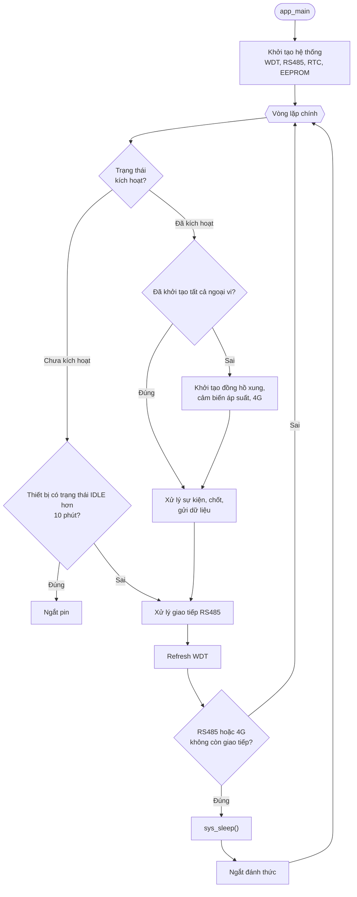

# WM03A Application

## 1. Tổng quan

Firmware ứng dụng WM03A chạy trên STM32L431RCT6 và được bootloader nhảy vào sau khi reset (xem [Bootloader](bootloader.md)). Vòng lặp chính nằm trong `app_main()`: hàm này khởi tạo hệ thống, sau đó lặp vô hạn để xử lý giao tiếp, tiết kiệm năng lượng và trạng thái kích hoạt.

## 2. Vị trí ứng dụng trong Flash

Ứng dụng được lưu trong hai slot A và B. Bootloader chọn slot hợp lệ để nhảy vào. Firmware được biên dịch cho đúng địa chỉ của slot đích, nên không thể chạy trực tiếp từ slot còn lại.

| Vùng | Địa chỉ bắt đầu | Kích thước | Macro |
|---|---|---|---|
| Slot A Metadata | `0x08008000` | 2 KB | `SLOT_A_METADATA_ADDR` |
| Slot A Firmware | `0x08008800` | 110 KB | `SLOT_A_START_ADDR` |
| Slot B Metadata | `0x08024000` | 2 KB | `SLOT_B_METADATA_ADDR` |
| Slot B Firmware | `0x08024800` | 110 KB | `SLOT_B_START_ADDR` |

### 2.1. Bảng vector ngắt

Ở đầu mỗi slot firmware là bảng vector. Hai word đầu được bootloader dùng khi nhảy vào ứng dụng:

| Offset | Nội dung | Dùng bởi |
|---|---|---|
| `0x00` | Giá trị khởi tạo MSP | `jump_to_app()` |
| `0x04` | Địa chỉ Reset Handler | `jump_to_app()` |

Trước khi gọi Reset Handler, bootloader đặt `SCB->VTOR` bằng địa chỉ đầu slot, nên các ngắt của ứng dụng được lấy từ bảng vector của slot đó.

### 2.2. Vùng RAM

| Vùng | Địa chỉ | Kích thước | Ghi chú |
|---|---|---|---|
| RAM | `0x20000000` | 48 KB | Dữ liệu ứng dụng, stack, heap |
| RAM_MANUAL | `0x10000000` | 1 KB | Metadata OTA |
| RAM_NOINIT | `0x10000400` | 15 KB | Trạng thái giữ qua reset (xem [SRAM](sram.md)) |

## 3. Khởi tạo hệ thống

Thứ tự khởi tạo trong `app_main()`:

1. `drv_wdt_init()`: khởi tạo watchdog.
2. `drv_rs485_init()`: khởi tạo RS485.
3. `sv_485_communication_init()`: khởi tạo giao thức RS485.
4. `sys_debug_init()`: khởi tạo log debug.
5. `sv_time_init()`: khởi tạo thời gian hệ thống.
6. `app_storage_init()`: khởi tạo lưu trữ EEPROM.
7. `app_storage_increase_reset_count()`: tăng số lần MCU reset.
8. Ghi log phiên bản firmware (vùng A hoặc B theo địa chỉ vector table).
9. Ghi mốc thời gian không hoạt động ban đầu (`u32TimestampUnactiveStart`).

Các ngoại vi đo đếm, cảm biến và module 4G chưa được khởi tạo ở bước này. Chúng chỉ khởi tạo một lần khi thiết bị đã kích hoạt ([mục 4.2](#42-rẽ-nhánh-theo-trạng-thái-kích-hoạt)).

## 4. Vòng lặp chính

### 4.1. Các bước mỗi vòng

1. `app_protocol_update()`: cập nhật quyền truy cập vào thiết bị.
2. `app_485_communication_execute()`: xử lý giao tiếp RS485.
3. `drv_wdt_clear_refresh_count()` và `sv_charge_wd_rst()`: refresh watchdog và heartbeat sạc.
4. Nếu không có giao tiếp RS485 và không có giao tiếp 4G, gọi `sys_sleep()`.
5. Nếu đang giao tiếp RS485, cập nhật mốc không hoạt động.
6. Rẽ nhánh theo trạng thái kích hoạt ([mục 4.2](#42-rẽ-nhánh-theo-trạng-thái-kích-hoạt)).

### 4.2. Rẽ nhánh theo trạng thái kích hoạt

**Chưa kích hoạt (`DEVICE_ACTIVATION_STATUS_DEACTIVED`):**

- Nếu thời gian từ mốc không hoạt động lớn hơn 10 phút (`UNACTIVATED_SHUTDOWN_TIMEOUT_SECOND`), gọi `sv_charge_disconnect_battery()` để ngắt pin.
- Không khởi tạo ngoại vi đo đếm và không thực hiện chốt, gửi.

**Đã kích hoạt (`DEVICE_ACTIVATION_STATUS_ACTIVED`):**

- Lần đầu (`bInitialized` = false): đặt `bInitialized` = true, rồi gọi `sv_pulse_meter_init()`, `sv_pressure_sensor_init()` và `app_cellular_init()`.
- Mỗi vòng: gọi `app_event_execute()`, `app_latch_execute()` và `app_push_execute()`.
- Sau đó cập nhật mốc không hoạt động.

### 4.3. Tiết kiệm năng lượng

`sys_sleep()` chỉ được gọi khi không có giao tiếp RS485 và không có phiên 4G đang hoạt động. Thiết bị được đánh thức bằng ngắt.

## 5. Lưu đồ

## 6. Tài liệu liên quan