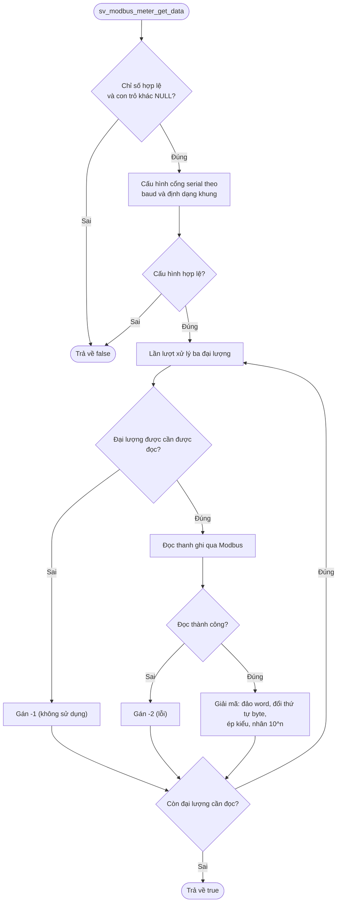

# Đồng hồ Modbus RTU

## 1. Tổng quan

WM03A đọc tối đa bốn đồng hồ nước giao tiếp Modbus RTU qua RS485. Mỗi đồng hồ có thể đọc ba đại lượng: tổng lưu lượng xuôi, tổng lưu lượng ngược và lưu lượng tức thời. Mỗi đại lượng có thể bật/tắt độc lập, khai báo thanh ghi, kiểu dữ liệu, đảo word và số mũ thập phân riêng.

Các lớp xử lý:

| Lớp | File | Trách nhiệm |
|---|---|---|
| Service | `sv_modbus_meter.c` | Lưu cấu hình, cấu hình cổng serial theo đồng hồ, đọc từng đại lượng và giải mã |
| Driver | `drv_modbus.c` | Đóng gói khung Modbus RTU, gửi nhận qua RS485, kiểm tra CRC16 |
| Driver | `drv_rs485.c` | Cấu hình UART, bật nguồn và điều khiển chiều truyền/nhận |

## 2. Phần cứng liên quan

- RS485 dùng USART1 (PB6/PB7) với transceiver MAX3485.
- Nguồn MAX3485 bật bằng chân PB4 (`PWR_485`) trước khi gửi và tắt sau khi nhận xong.
- Chiều truyền/nhận điều khiển bằng chân PB5 (`DE_485`).

## 3. Cấu hình

### 3.1. Cấu hình kết nối

| Trường | Ý nghĩa |
|---|---|
| `u8SlaveAddress` | Địa chỉ slave Modbus |
| `u32BaudRate` | Tốc độ truyền |
| `u8SerialConfig` | Định dạng khung |
| `u8ReadFuncCode` | Mã hàm đọc thanh ghi |

Nếu `u32BaudRate` bằng 0 hoặc `u8SerialConfig` không hợp lệ, việc đọc đồng hồ thất bại ngay.

Mã hàm đọc thanh ghi gồm `0x03` (Read Holding Registers) và `0x04` (Read Input Registers).

### 3.2. Cấu hình đại lượng

Mỗi đại lượng (`sForwardTotalizer`, `sReverseTotalizer`, `sFlowRate`) có các trường:

| Trường | Ý nghĩa |
|---|---|
| `u8ParameterEnable` | Bật/tắt đọc đại lượng |
| `u16RegisterAddress` | Địa chỉ thanh ghi bắt đầu |
| `u8DataType` | [Kiểu dữ liệu](#33-kiểu-dữ-liệu) |
| `u8WordSwap` | Đảo thứ tự word 16-bit khi dữ liệu từ 32 bit trở lên |
| `s8ScaleFactorExponent` | Số mũ thập phân, giá trị cuối = giá trị đọc × 10^n |

### 3.3. Kiểu dữ liệu

| Hằng số | Kiểu C | Số byte | Số thanh ghi 16-bit |
|---|---|---:|---:|
| `MODBUS_INT16` | `int16_t` | 2 | 1 |
| `MODBUS_UINT16` | `uint16_t` | 2 | 1 |
| `MODBUS_INT32` | `int32_t` | 4 | 2 |
| `MODBUS_UINT32` | `uint32_t` | 4 | 2 |
| `MODBUS_FLOAT` | `float` | 4 | 2 |
| `MODBUS_INT64` | `int64_t` | 8 | 4 |
| `MODBUS_UINT64` | `uint64_t` | 8 | 4 |
| `MODBUS_DOUBLE` | `double` | 8 | 4 |

## 4. Quy trình đọc một đồng hồ

Mỗi lần đọc thanh ghi (`drv_modbus_master_read_register`):

1. Bật nguồn RS485.
2. Gửi khung: địa chỉ slave, mã hàm, địa chỉ thanh ghi, số thanh ghi, CRC16.
3. Chờ phản hồi trong `MODBUS_RESPONSE_TIMEOUT` (1 giây), kiểm tra CRC.
4. Tắt nguồn RS485.
5. Nếu mã hàm phản hồi là `mã hàm + 0x80`, coi là lỗi exception và trả về `MODBUS_EXCEPTION`, mã exception nằm trong byte đầu dữ liệu.
6. Nếu thành công, bỏ byte số lượng dữ liệu và trả về dữ liệu thô.

## 5. Giải mã dữ liệu

Quy trình giải mã trong `sv_modbus_meter_decode`:

1. **Đảo word** (nếu `u8WordSwap` = 1 và kiểu từ 32 bit trở lên): với 4 byte, đổi hai word 16-bit đầu/sau; với 8 byte, đổi thứ tự 4 word.
2. **Đổi thứ tự byte sang little-endian**, sau đó ép kiểu về kiểu đã khai báo.
3. **Nhân số mũ:** nếu `s8ScaleFactorExponent` âm thì chia `10` nhiều lần, dương thì nhân.

Ví dụ: thanh ghi trả về `0x0001 0x86A0` với `MODBUS_UINT32`, không đảo word, số mũ `-1` cho giá trị 100000 / 10 = 10000.

## 6. Giá trị đặc biệt khi lỗi

| Trường hợp | Giá trị gán |
|---|---|
| Đại lượng không bật | `-1` |
| Đọc thanh ghi thất bại | `-2` |

Giá trị `-1` và `-2` là mã lỗi và được gán cho kiểu `double`. Các giá trị đo được thực tế là số không âm nên sẽ không có giá trị này.

## 8. Tài liệu liên quan
