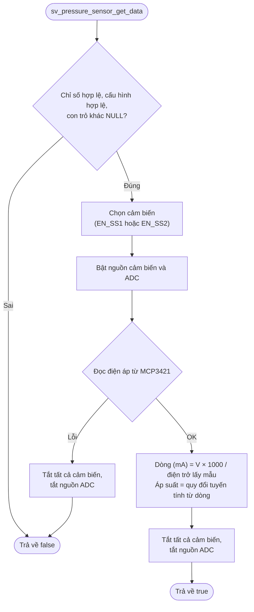

# Cảm biến áp suất

## 1. Tổng quan

WM03A đo áp suất từ tối đa hai cảm biến đầu ra dòng 4–20 mA. Tín hiệu dòng được chuyển thành điện áp qua điện trở lấy mẫu, rồi đưa vào ADC ngoài MCP3421 qua I2C. Firmware chọn kênh cảm biến bằng hai chân enable, bật nguồn ADC và cảm biến khi đo, và tắt sau khi đo xong.

Các lớp xử lý:

| Lớp | File | Trách nhiệm |
|---|---|---|
| Service | `sv_pressure_sensor.c` | Lưu cấu hình, chọn kênh, quy đổi điện áp sang áp suất |
| Driver | `drv_ext_adc.c` | Điều khiển nguồn, chọn cảm biến, đọc và giải mã dữ liệu MCP3421 |

## 2. Phần cứng liên quan

| Chân | Tên | Chức năng |
|---|---|---|
| PC11 | `PWR_SS` | Nguồn cảm biến áp suất (mức thấp = bật) |
| PB3 | `PWR_E_ADC` | Nguồn ADC ngoài (mức thấp = bật) |
| PD2 | `EN_SS1` | Cho phép cảm biến 1 |
| PC12 | `EN_SS2` | Cho phép cảm biến 2 |
| PB8, PB9 | I2C1 SCL/SDA | Giao tiếp MCP3421 |

Tại một thời điểm chỉ một cảm biến được bật. Chọn cảm biến 1 đặt `EN_SS1` = 1 và `EN_SS2` = 0; chọn cảm biến 2 làm ngược lại.

## 3. Cấu hình

Cấu trúc `Pressure_Sensor_Config_t` (đóng gói trong `Pressure_Sensor_Config_Parameter_t`) chứa các tham số quy đổi:

| Trường | Ý nghĩa |
|---|---|
| `fMinCurrent` | Dòng tối thiểu của cảm biến (mA) |
| `fMaxCurrent` | Dòng tối đa của cảm biến (mA) |
| `fMinPressure` | Áp suất tương ứng với dòng tối thiểu (bar) |
| `fMaxPressure` | Áp suất tương ứng với dòng tối đa (bar) |

Hàm `sv_pressure_sensor_set_config(u8MeterIndex, pConfig)` sao chép cấu hình vào RAM.

Điều kiện hợp lệ khi đọc: `fMinCurrent < fMaxCurrent` và `fMinPressure < fMaxPressure`. Nếu không thoả mãn, hàm đọc trả về lỗi.

## 4. Quy trình đo



Công thức quy đổi tuyến tính:

```text
P = Pmin + (I − Imin) × (Pmax − Pmin) / (Imax − Imin)
```

Với `I` là dòng tính từ điện áp đo được, `SHUNT_RESISTOR_ADC = 25` là điện trở lấy mẫu (Ω).

## 5. Driver ADC ngoài (MCP3421)

### 5.1. Thông số cấu hình

| Tham số | Giá trị | Macro |
|---|---|---|
| Độ phân giải | 18 bit | `EXT_ADC_CR_S_18BIT` |
| Hệ số khuếch đại PGA | ×4 | `EXT_ADC_CR_G_X4` |
| Chế độ | One-shot | `EXT_ADC_CR_MODE_ONE_SHOT` |
| Cờ RDY | Bật | `EXT_ADC_CR_RDY_EN` |
| Địa chỉ I2C | `EXT_ADC_ADDR` | `0x69` |

- Với 18 bit, LSB là 15,625 µV trước PGA. Sau khi chia cho hệ số khuếch đại, giá trị điện áp thực được tính trong hàm đọc.

### 5.2. Các hàm chính

| Hàm | Mô tả |
|---|---|
| `drv_ext_adc_init()` | Tắt nguồn ADC, tắt cảm biến, khởi tạo I2C |
| `drv_ext_adc_pwr_on()` / `pwr_off()` | Bật/tắt nguồn cảm biến và ADC |
| `drv_ext_adc_enable_sensor1()` / `sensor2()` | Chọn kênh cảm biến |
| `drv_ext_adc_disable_all_sensors()` | Tắt cả hai chân enable |
| `drv_ext_adc_read()` | Gửi cấu hình, đọc dữ liệu, giải mã thành điện áp |

### 5.3. Quy trình đọc

1. Gửi byte cấu hình tới ADC.
2. Đọc 4 byte (18 bit) hoặc 3 byte (các độ phân giải khác). Byte cuối là thanh ghi cấu hình.
3. Nếu lỗi I2C hoặc bit RDY vẫn bằng 1 (chưa sẵn sàng), chờ `EXT_ADC_CONVERSION_TIMEOUT` (300 ms) rồi đọc lại.
4. Sau lần thử lại, kiểm tra tiếp byte cấu hình có khớp `EXT_ADC_CR` ở 5 bit thấp. Nếu không khớp, trả về lỗi.
5. Ghép các byte dữ liệu theo big-endian, lấy đủ N bit có dấu, nhân LSB rồi chia cho `2^G`.

## 6. Tài liệu liên quan