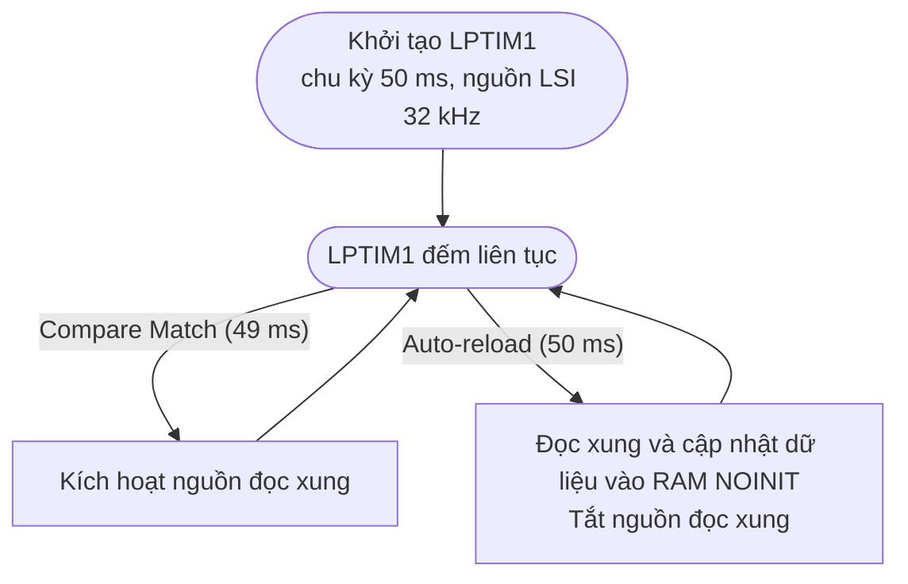
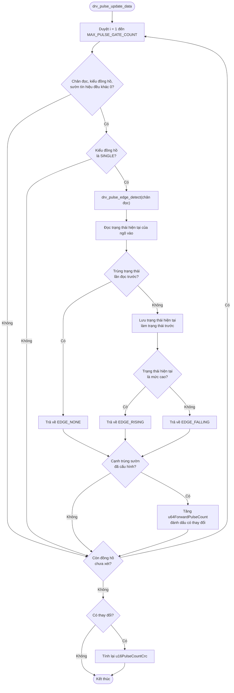

# Đếm xung đồng hồ nước

## 1. Tổng quan

WM03A đọc tối đa bốn đồng hồ nước phát xung. Mỗi đồng hồ được nối vào một ngõ vào xung (`PULSE1_IN` đến `PULSE4_IN`). Firmware quét các ngõ vào định kỳ bằng LPTIM1, phát hiện cạnh tín hiệu, cộng dồn số xung vào bộ đếm và lưu bộ đếm vào SRAM giữ qua reset (`RAM_NOINIT`). Số xung được quy đổi thành thể tích bằng hệ số xung (`u16PulseFactor`).

Các lớp xử lý:

| Lớp | File | Trách nhiệm |
|---|---|---|
| Service | `sv_pulse_meter.c` | Lưu cấu hình và hệ số xung, quy đổi xung sang m³ và lưu lượng |
| Driver | `drv_pulse.c` | Bật/tắt đọc ngõ vào, phát hiện cạnh, cộng dồn bộ đếm, quản lý CRC |
| Driver | `drv_timer.c` | Khởi động LPTIM1 tạo chu kỳ đọc, gọi callback ngắt |

## 2. Phần cứng liên quan

| Đồng hồ | Ngõ vào | Chân enable | Ghi chú |
|---|---|---|---|
| 1 | PA8 (`PULSE1_IN`) | PB12 (`PULSE1_EN`) | |
| 2 | PA9 (`PULSE2_IN`) | PB13 (`PULSE2_EN`) | |
| 3 | PA10 (`PULSE3_IN`) | PB14 (`PULSE3_EN`) | |
| 4 | PA11 (`PULSE4_IN`) | PB15 (`PULSE4_EN`) | |

- Chân enable mức thấp là bật đọc, mức cao là tắt.
- Chỉ bật chân enable trong thời gian đo để tiết kiệm năng lượng.

## 3. Cấu hình

| Trường | Kiểu | Ý nghĩa |
|---|---|---|
| `u16PulseFactor` | `uint16_t` | Hệ số xung (xung/m³). Phải khác 0, nếu không dữ liệu không được quy đổi |
| `u8PulseType` | `uint8_t` | Kiểu đồng hồ xung: `0x00` `PULSE_TYPE_SINGLE`, `0x01` `PULSE_TYPE_ENCODER_AB`, `0x02` `PULSE_TYPE_DIRECTION` |
| `u8Pin1Select` | `uint8_t` | Ngõ vào xung 1: `0x01`–`0x04` (chân 1–4) |
| `u8Pin2Select` | `uint8_t` | Ngõ vào xung 2: `0x00` không dùng, `0x01`–`0x04` (chân 1–4) |
| `u8EdgeType` | `uint8_t` | Sườn tín hiệu đếm xung: `0x01` cạnh lên, `0x02` cạnh xuống |

Khi chưa cấu hình (hệ số xung bằng 0), `sv_pulse_meter_get_data` trả về `false`.

## 4. Đọc ngõ vào và phát hiện cạnh

### 4.1. Khởi tạo

1. Bật đọc cả bốn chân enable.
2. Chờ 1 ms để tụ điện ổn định.
3. Đọc trạng thái ban đầu của bốn ngõ vào và lưu vào biến `bPreviousPulseX`.
4. Tắt đọc cả bốn chân enable.
5. Khởi động LPTIM1 với chu kỳ `PULSE_READ_PERIOD` (50 ms).

### 4.2. Chu kỳ đọc bằng LPTIM1

LPTIM1 chạy ở chế độ PWM có ngắt, dùng nguồn clock LSI 32 kHz, với chu kỳ `PULSE_READ_PERIOD` = 50 ms. Khoảng cách giữa hai ngắt là 1 ms. Trong mỗi chu kỳ, hai ngắt được gọi theo thứ tự:

| Thứ tự | Thời điểm | Callback | Hàm xử lý | Hành động |
|---|---|---|---|---|
| 1 | 49 ms | `HAL_LPTIM_CompareMatchCallback` | `drv_pulse_interrupt_handler(false)` | Bật đọc cả bốn chân enable |
| 2 | 50 ms | `HAL_LPTIM_AutoReloadMatchCallback` | `drv_pulse_interrupt_handler(true)` | Đọc và cộng dồn bộ đếm, tắt đọc cả bốn chân enable |

**Lưu đồ hoạt động của LPTIM1:**



### 4.3. Phát hiện cạnh

`drv_pulse_edge_detect()` so sánh trạng thái hiện tại với trạng thái lần đọc trước của cùng ngõ vào:

- Không đổi: `EDGE_NONE`.
- Từ thấp lên cao: `EDGE_RISING`.
- Từ cao xuống thấp: `EDGE_FALLING`.

## 5. Cộng dồn bộ đếm

Hàm `drv_pulse_update_data()` duyệt bốn cấu hình ngõ vào:

1. Bỏ qua cấu hình nếu chân đọc, kiểu đồng hồ hoặc sườn tín hiệu bằng `0`.
2. Với kiểu `PULSE_TYPE_SINGLE`, phát hiện cạnh của chân đọc. Nếu cạnh trùng với sườn đã cấu hình, tăng `u64ForwardPulseCount` của đồng hồ đó.
3. Nếu có thay đổi, tính lại `u16PulseCountCrc` trên toàn bộ mảng `sPulseCount`.

Các kiểu `PULSE_TYPE_ENCODER_AB` và `PULSE_TYPE_DIRECTION` chưa được xử lý trong hàm này.



## 6. Bộ đếm và lưu trữ

Bộ đếm nằm trong vùng `RAM_NOINIT`, được giữ qua reset:

| Biến | Kiểu | Ý nghĩa |
|---|---|---|
| `u32PulseCountMagic` | `uint32_t` | Magic `0x12345678`, xác nhận dữ liệu hợp lệ |
| `sPulseCount[4]` | `Pulse_Count_t[]` | Tổng xuôi và tổng ngược theo xung, mỗi đồng hồ 16 B |
| `u16PulseCountCrc` | `uint16_t` | CRC16 của `sPulseCount` |

Khi khởi động, `drv_pulse_count_init()` chỉ nạp giá trị từ EEPROM nếu magic sai hoặc CRC không khớp. Nếu magic và CRC đều hợp lệ, bộ đếm trong RAM được giữ nguyên.

Truy cập bộ đếm từ tầng trên được bảo vệ bằng `__disable_irq()` và `__enable_irq()`, để tránh đọc trong lúc ngắt đang cập nhật.

## 7. Quy đổi và API

| Hàm | Mô tả |
|---|---|
| `sv_pulse_meter_get_data(i, &data)` | Trả tổng xuôi, tổng ngược (m³) và lưu lượng (m³/s theo `dPulseFrequency`) |
| `sv_pulse_meter_get_count(i, &count)` | Lấy bộ đếm xung thô |
| `sv_pulse_meter_set_count(i, &count)` | Ghi bộ đếm xung thô (dùng khi thay đồng hồ hoặc khôi phục) |
| `sv_pulse_meter_set_config(i, &config)` | Ghi cấu hình ngõ vào và hệ số xung |

Công thức quy đổi:

```text
Tổng xuôi (m³) = u64ForwardPulseCount / u16PulseFactor
Tổng ngược (m³) = u64ReversePulseCount / u16PulseFactor
Lưu lượng = dPulseFrequency / u16PulseFactor
```

## 8. Tài liệu liên quan